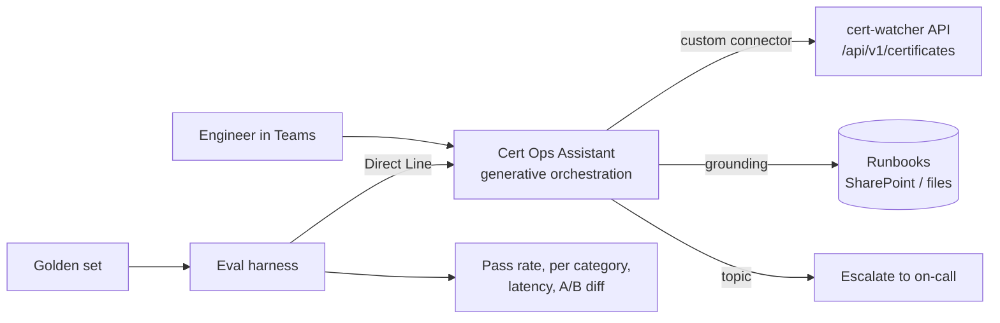

# Cert Ops Assistant

[](https://github.com/Hussain-MD/cert-ops-agent/actions/workflows/ci.yml)

A Microsoft Copilot Studio agent that helps operations engineers deal with expiring TLS certificates. Ask it in
Teams "what is critical?" or "how do I renew the payments gateway certificate?" and it combines live status from
[cert-watcher](https://github.com/Hussain-MD/cert-watcher) with the team's runbooks, then points you to the owner.

The repo holds the agent's specification (instructions, topics, connector, knowledge), the discovery work behind
it, and an evaluation harness that scores the published agent against a golden set.

## How it works



- **Generative orchestration** decides per question whether to call the cert-watcher action, search the
  runbooks, or run a topic.
- **Guardrails** live in the [instructions](agent/instructions.md): read-only, no private keys, fixed refusal for
  off-topic requests, no invented answers, instructions never revealed.
- **Evaluation:** 25 golden cases across tool use, grounding and guardrails. The harness talks to the published
  agent over Direct Line, one fresh conversation per case, and reports pass rate per category and latency.
  `compare` diffs two runs to A/B instruction versions or catch regressions after a model update.

## Repository

```text
docs/discovery.md        problem, users, user stories, acceptance criteria, NFRs, success metrics
docs/build-guide.md      step-by-step build in Copilot Studio
agent/instructions.md    versioned agent instructions (prompt)
agent/topics/            topic definitions (Copilot Studio YAML)
connector/               custom connector for cert-watcher (OpenAPI 2.0)
knowledge/               runbooks used for grounding
demo/                    starts cert-watcher with known demo certificates
evals/                   golden set, harness, A/B compare, unit tests
```

## Run the evaluation

See [docs/build-guide.md](docs/build-guide.md) to build and publish the agent first.

```bash
pip install -r requirements.txt
export COPILOT_TOKEN_ENDPOINT='<token endpoint from Copilot Studio>'
cd evals
python -m certops_eval.run --label instructions-v1 --out results/v1.json
python -m certops_eval.compare results/v1.json results/v2.json
```

## Development

```bash
pip install -r requirements-dev.txt
ruff check .
pytest
```

CI lints and tests the harness, validates the golden set, and checks the connector and topic files on every
push. The **Agent evaluation** workflow runs the golden set against the live agent on demand and weekly.

## Roadmap

- v2: create change tickets through a Power Automate flow, with explicit user confirmation
- cert-watcher behind Azure API Management with Entra ID OAuth for the connector
- LLM-as-judge groundedness scoring with Azure AI Foundry evaluations, alongside the deterministic checks
- Application Insights telemetry and an adoption dashboard
- A Semantic Kernel version of the agent for comparison with the low-code build

## License

[MIT](LICENSE)
